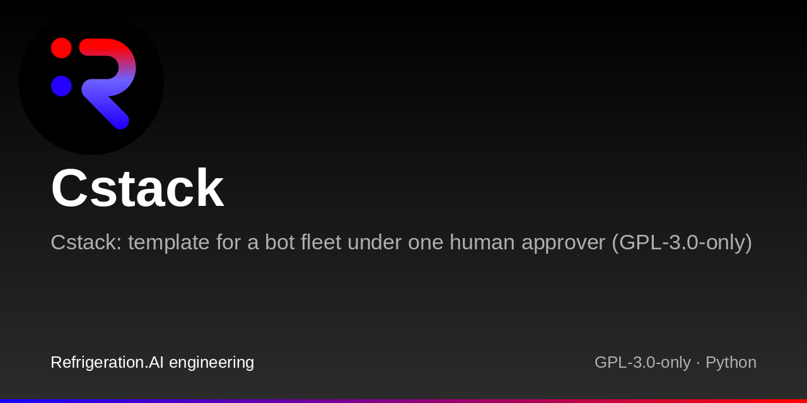
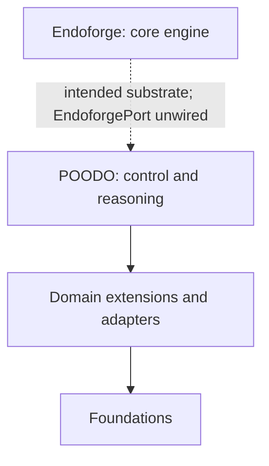

# Cstack

Cstack: template for a bot fleet under one human approver (GPL-3.0-only)

[](LICENSE)

## Family

| Repository | Role | Relation |
|---|---|---|
| [cstack](https://github.com/Akilleez-QA/cstack) | Runs Foundations behind pinned adapters under one human approver | Host |
| [foundation-engine](https://github.com/Akilleez-QA/foundation-engine) | TypeScript and three.js framework for browser games | Foundation |
| [foundation-math](https://github.com/Akilleez-QA/foundation-math) | Exact mathematical kernels and physics research tools | Foundation |
| [foundation-film](https://github.com/Akilleez-QA/foundation-film) | Film-production acceptance checks | Foundation |
| [foundation-refrigeration](https://github.com/Akilleez-QA/foundation-refrigeration) | Refrigeration data and checks | Foundation |
| [foundation-robotics](https://github.com/Akilleez-QA/foundation-robotics) | Physics checks for motion | Foundation |
| [foundation-template](https://github.com/Akilleez-QA/foundation-template) | Minimal Foundation to copy for a new domain | Foundation |
| [endoforge](https://github.com/Akilleez-QA/endoforge) | Core engine for coding agents, checks, caching and evidence receipts | Intended execution substrate |
| [poodo](https://github.com/Akilleez-QA/poodo) | Reasoning skill that shows evidence before it acts | Tool |

## Map

The intended design places Endoforge at the engine layer: it runs coding agents with checks, caching and evidence receipts. POODO runs on Endoforge as the control and reasoning layer (`poodo_core/`); domains and Foundations plug in through adapters.

That is the target architecture. Today POODO uses its existing Foundation adapters directly. `EndoforgePort` is reserved and unimplemented, exposes no callable synthesis method, and Endoforge is not wired into Cstack. POODO does not run on Endoforge today. See the [Endoforge interface status](docs/icd/icd-endoforge.md).



## Status

Cstack is a template for running a fleet of AI bots under one human approver. Copy it, name your bots, plug in your own domains, and every action a bot takes goes through a control core that records goals, scoped authority and evidence.

This is an early template; verify the configuration and capabilities you choose.

## Quickstart

Python 3.11 or newer on Linux or macOS.

```sh
python3 -m venv .venv && . .venv/bin/activate
pip install -r requirements.txt -r ci/requirements.txt
cp cstack.config.example.json cstack.config.json
python -B cli.py < examples/scalar-and-negative.json
python -B -m unittest discover -s tests
bash ci/run-local.sh python links
```

## What is inside

| Path | What |
|---|---|
| `poodo_core/`, `contracts/`, `schemas/` | The control core: goals, phases, authority grants, decisions, attempts and evidence receipts, with the JSON contracts they obey |
| `adapters/`, `extensions/`, `bootstrap.py` | Capability ports: bounded stdio bridges from the core to each domain, registered once in `bootstrap.DOMAINS` |
| `aors/`, `tools/` | The bot layer: areas of responsibility per bot, AOR sessions over MCP, fleet mail, approvals, a witnessed ledger, and the merge train |
| `foundations/` | Vendored Foundations: math research layer, film, refrigeration, robotics and the template to copy |
| `reasoning/poodo` | The POODO reasoning method the core enforces |
| `vendor/foundation-math-v014` | Foundation Math, byte-pinned |
| `ci/`, `.github/` | The local CI script and the GitHub workflow that calls it |

## Foundations

A Foundation is a domain package that Cstack runs through an adapter. Each one has its own repository, listed in the Family table above. Some are vendored, meaning copied into this repository, and the rest are only linked.

| Foundation | In this repository | How Cstack uses it |
|---|---|---|
| [foundation-math](https://github.com/Akilleez-QA/foundation-math) | `vendor/foundation-math-v014/`, plus the research layer in `foundations/math/` | Vendored copy of v0.14, run through `adapters/math_stdio.py` and `extensions/foundation_math.py` |
| [foundation-film](https://github.com/Akilleez-QA/foundation-film) | `foundations/film/` | Vendored copy of the repository, same files |
| [foundation-refrigeration](https://github.com/Akilleez-QA/foundation-refrigeration) | `foundations/refrigeration/` | Vendored copy of the repository, same files |
| [foundation-robotics](https://github.com/Akilleez-QA/foundation-robotics) | `foundations/robotics/` | Vendored copy of the repository, same files |
| [foundation-template](https://github.com/Akilleez-QA/foundation-template) | `foundations/template/` | Vendored copy of the repository, same files |
| [foundation-engine](https://github.com/Akilleez-QA/foundation-engine) | Not included | Linked only. No adapter or pin yet |
| [endoforge](https://github.com/Akilleez-QA/endoforge) | Pinned copy proposed at vendor/endoforge/ in [PR #16](https://github.com/Akilleez-QA/cstack/pull/16); inclusion in progress | Lifecycle core slice only; no runtime wiring |
| [poodo](https://github.com/Akilleez-QA/poodo) | `reasoning/poodo/` | Earlier snapshot of the skill that the core follows |

### How pins work

Cstack does not trust a vendored Foundation just because it is present. Each one ships a `SOURCE-MANIFEST.json` that lists a hash for every file. `contracts/SOURCE-PINS.json` records the expected hash of each manifest, and the adapters refuse to run a Foundation whose files or manifest don't match. To update a Foundation, copy in the new version, rebuild its manifest with its `tools/build_manifest.py`, update the pin, and run all the test suites on a reviewed branch. There is no automatic upgrade. The pin values are listed in [docs/icd/icd-foundations.md](docs/icd/icd-foundations.md). A matching pin proves that the bytes are unchanged. It does not prove that the content is correct.

## Verification

Run the root and Foundation unittest suites normally and with optimization enabled.

## Define your bots

1. Edit `aors/fleet.json`. Each bot has a `slug`, the `slices` of the repo it owns, what it does not own, and `effects`. Anything that sends, pays, posts, files or deletes is `ask`, which routes to the one human approver.
2. Choose branch lanes for your own workflow.
3. Validate your registry with `adapters.aor_registry.load_fleet` against `contracts/aor.schema.json`.

## Wire the merge train

`tools/merge_train.py` merges open PRs in dependency order. A PR merges only when its body lists the local checks that were run, it stays inside its bot's slice, and it merges cleanly. It never deletes branches or force-pushes. `python3 tools/merge_train.py --wip` shows open PRs per lane. Run it from a timer against a fresh worktree of `main`.

## Add a domain

Copy `foundations/template`, rename it, add tools and their pins, and register it in `bootstrap.DOMAINS`. The refrigeration, film and robotics domains show three complete examples.

## Not included

No business data, no user or site data, and no engineering, safety or compliance determination. The example domains are references to learn from, not certified tools.

## Documentation

- [Project documents](https://github.com/Akilleez-QA/cstack/tree/main/docs): requirements, architecture, Foundation interfaces, verification and configuration management.
- [Code comment rule](docs/rules/no-comments.md).
- [Control contracts](contracts/DECISION.md) and [capability contract](contracts/INTERFACES.md).


## Layout

| Path | Contents |
|---|---|
| `README.md` | Status, setup and entry points |
| `docs/` | Requirements, architecture, interfaces, verification, configuration management and rules |
| `examples/` | CLI input examples |
| `tests/` | Root unittest suite |
| `cli.py`, `bootstrap.py`, `__init__.py`, `__main__.py` | Python entry points and composition kept at the repository root |

The root Python files stay at the top level on purpose.

## Contributing

See [CONTRIBUTING.md](CONTRIBUTING.md) for the contribution workflow and local checks.

## Security

See [SECURITY.md](SECURITY.md) for the security contact and reporting guidance.

## License

This project is available under the GNU General Public License v3.0 only (GPL-3.0-only). If you want to use it to create a product or service under different terms, commercial licenses are available from Refrigeration.AI. Contact craig@nh3.biz.
