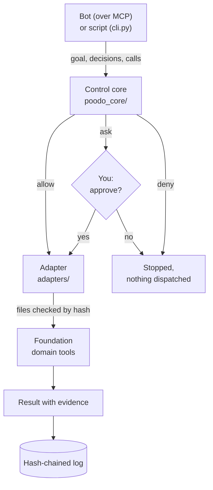

# Cstack

Cstack is a local-first system for building and running software with AI agents under your control. One control core owns every goal, decision, permission and piece of evidence. Domain packages called Foundations plug in to supply exact knowledge and checks. [EndoForge](https://github.com/Akilleez-QA/endoforge), its software engine, is meant to generate code that the core evaluates, then activates, keeps or throws away. Anything risky waits for one human to approve it.

[](LICENSE)

**What works today:** the control core with its approvals and hash-chained ledger; six Foundations wired through checked adapters; an MCP server that gives each agent its own governed session; and forge goals, where a model writes one program that is compiled in an EndoForge workcell and checked against a Foundation. **Not yet:** generated user interfaces, the activate, keep and dispose lifecycle for generated software, and EndoForge's parallel agents and code reuse. See [status and limitations](#status-and-limitations).

A *bot* here is an AI agent, such as a Claude Code or Codex session, that reaches Cstack over MCP (the Model Context Protocol), or a script that hands Cstack a JSON file. To use it, you fork it, list your bots in `aors/fleet.json` (one area of responsibility, or AOR, per bot), add your own tools, and point your agents at its MCP server. Leave the control core unchanged so upstream fixes merge cleanly.

## Why

Letting AI agents build and run software is easy to start and hard to trust. You need to know what each agent did, why, with which code, and whether you said yes. Cstack puts one control core between the agents and the world, whether they call tools or generate code:

- **A reason before every action.** A bot must state its goal, record the decision behind each call and say what result it expects, before anything runs. The core enforces that order.
- **Risky actions wait for you.** Every call has an effect: `allow`, `ask` or `deny`. The bot registry marks sending, paying, posting, filing and deleting as `ask`, so a tool of that kind waits for you. Cstack shows you the exact request and runs it only if you say yes. Your yes is tied to that request's SHA-256 digest, so it can't be reused for a different one.
- **A record of every step.** Each step is appended to a hash-chained log (the *ledger*), so you can check later what ran, with which code, under whose approval.
- **Pinned domain tools.** Calculations and checks live in *Foundations*: small packages of domain tools whose every file is listed by hash. Cstack refuses to run a Foundation whose files have changed, and every result carries its evidence.

## See it work

This example hands Cstack a JSON file that stands in for what a bot would send: a goal and one tool call marked `ask`. The tool only echoes its input; the point is the stop. Cstack shows you the exact request:

```sh
python -B cli.py --approver < examples/ask-approval.json
```

```text
Approve decision-1 foundation_template.echo_observation goal=synthetic-template@1 sha256=60f2b7ba86e3bfcfa817c2635415523734ae0cc8ebfa51f39bde594fc3416bf7
{"arguments": {"observation": "fixture reading 7"}, "capability_id": "foundation_template", "decision_id": "decision-1", ...}
Type approve to allow: approve
```

Type anything other than `approve`, or leave out `--approver`, and the call is never dispatched: the result says `"run_status": "stopped"` and `"execution_certainty": "not_dispatched"`.

After you approve, Cstack prints the run as one JSON document, and the same steps go into the ledger. Its `events` list is the whole story, in order. Each event carries its own hash and the hash of the one before it, so corruption or a careless edit shows up. Summarised from one run, with hashes shortened (approval ids and times differ, so your hashes will too):

```text
seq  kind      what                          hash          prior
1    proposal  start_goal                    7d40af3f9ccc
2    decision  phase pontificate -> observe  0eb7b34c42db  7d40af3f9ccc
3    decision  phase observe -> orient       cbe281848503  0eb7b34c42db
4    decision  phase orient -> decide        843094c9c928  cbe281848503
5    decision  precommit (expected result)   6f949be0547e  843094c9c928
6    decision  phase decide -> orchestrate   32bed9851298  6f949be0547e
7    decision  approved by cli-owner         dbbdfca2391e  32bed9851298
8    action    dispatch                      c26863a347fd  dbbdfca2391e
9    outcome   observation_echoed            9c121b9171ac  c26863a347fd
```

The phases come from [POODO](https://github.com/Akilleez-QA/poodo), a reasoning method in the style of the OODA loop (observe, orient, decide, act) with a step in front: *pontificate* (frame the problem), *observe*, *orient*, *decide*, then *orchestrate* (carry out the calls). To move to the next phase the agent sends a short checkpoint: its rationale, the sources it read and the options it weighed. (In the example they are pre-written in the JSON file.) A call can run only in the last phase, and only after its expected result is on record.

When a bot runs over MCP instead, its `execute` call returns `approval_pending` at once, without dispatching. Your answer is recorded in an approval store under the bot's state directory, from your own shell, never from the bot's process; the agent then calls `execute` again. See [approve ask calls](docs/guides/how-to/approve-asks.md), including a current limitation of the answering tool.

## How it works



A bot reaches Cstack in one of two ways. `cli.py` runs one JSON file to the end, as in the example. `tools/cstack_mcp.py` is an MCP server for one bot. Register it in your agent's MCP settings as a stdio server; most clients take an entry like this, with absolute paths to your clone:

```json
{ "mcpServers": { "cstack-example": {
    "command": "/path/to/cstack/.venv/bin/python",
    "args": ["-B", "/path/to/cstack/tools/cstack_mcp.py", "--aor", "example", "--device", "example-host", "--state-root", "/tmp/cstack-state"] } } }
```

`--device` names the machine, and `--state-root` is where this bot's ledger and your approvals live. The agent then gets six tools: `aor` (who am I), `start_goal`, `advance` (next phase, with its checkpoint), `decide` (record a call and its expected result), `execute` and `ledger`. Their descriptions walk the agent through the phases.

Cstack doesn't start your agents. Each agent connects to its own server; the shared registry, ledgers and approval channel are what make them one team. With `--fleet-mail`, bots can also leave each other messages. Either way, the core walks the goal through the POODO phases and applies each call's effect: `allow` runs it, `ask` waits for you, `deny` refuses it. Which bot may do what is set in `aors/fleet.json`, a file you own. Nothing in a request, a bot's output or a tool's reply can raise its own permissions.

An allowed call goes to an adapter. The adapter checks the Foundation's files against the hashes in `contracts/SOURCE-PINS.json`, starts it as a child process, validates the reply, and checks the files again. A tool result is recorded as an observation, never as proof that the goal is done.

## Install and run

You need Linux or macOS, Python 3.12 or newer and `git`. Code-writing runs and the test suite also need Node 22 or newer and `npm`. No API key or model login is needed.

```sh
git clone https://github.com/Akilleez-QA/cstack
cd cstack
python3 -m venv .venv && . .venv/bin/activate
pip install -r requirements.txt -r ci/requirements.txt
npm ci --prefix adapters/workcell-toolchain --ignore-scripts --no-audit --no-fund
cp cstack.config.example.json cstack.config.json
```

The `npm` step installs the pinned compiler for code-writing runs; the approval example runs without it. `ci/requirements.txt` adds what the test suites need. `cstack.config.json` holds your host settings: where the ledger is written and what a code-writing run may use. Now run the example above. To check your install, run the test suite, then the Python, link and trace checks that CI runs:

```sh
python -B -m unittest discover -s tests
bash ci/run-local.sh python links trace
```

The [first-run tutorial](docs/guides/tutorials/first-run.md) walks through three runs and explains each step, in about ten minutes.

## What you can do with it

| Task | Guide |
|---|---|
| Approve calls from a terminal or an answer file | [Approve ask calls](docs/guides/how-to/approve-asks.md) |
| Name your bots, what they own and what needs your approval | [Define your bots](docs/guides/how-to/define-bots.md) |
| Let a real model write forge code (Claude Code subscription login) | [Use a real model](docs/guides/how-to/use-a-real-model.md) |
| Add your own domain tools | [Add a domain](docs/guides/how-to/add-a-domain.md) |
| Coding bots open pull requests; land them in dependency order | [Run the merge train](docs/guides/how-to/merge-train.md) |
| Run every check CI runs | [Run CI checks locally](docs/guides/how-to/run-ci-locally.md) |

### Bots that write code

Bots can also have code built for them. Cstack hands this *forge goal* to [EndoForge](https://github.com/Akilleez-QA/endoforge), the runtime where coding agents build real software: it finds, reuses or generates code, checks it inside fast V8-isolate workcells against an independent evaluator the code never saw, and records the result in a tamper-evident ledger so trusted code gets reused. Cstack vendors a pinned slice of EndoForge in `vendor/endoforge/` and runs one governed goal through its workcells; the code is checked against a Foundation's own answers on cases fixed before any code was written. This example replays a recorded model answer, so no model or account is needed:

```sh
CSTACK_STUB_TRANSPORT_SCRIPT=examples/forge/saturation-stub.json python -B cli.py < examples/forge/saturation-goal.json
```

It ends with `"assessment": "candidate_passed"` and a receipt naming the compiler (AssemblyScript 0.28.20), the Foundation version and every call the program made. The [tutorial](docs/guides/tutorials/first-run.md#5-run-a-forge-goal) walks through it, and [use a real model](docs/guides/how-to/use-a-real-model.md) switches to a real one.

## What's inside

| Path | What |
|---|---|
| `poodo_core/`, `contracts/`, `schemas/` | The control core: goals, phases, grants, decisions, attempts and receipts, and the JSON contracts they follow |
| `adapters/`, `extensions/`, `bootstrap.py` | The code between the core and each Foundation: adapters start and check it, extensions list its tools for the core, and `bootstrap.py` registers each domain once. The workcell runtime is in `adapters/workcell/` |
| `aors/`, `tools/` | The bot registry (AORs: each bot's area of responsibility), the MCP server, the approval channel and the merge train |
| `foundations/`, `vendor/` | Pinned copies of the Foundations and EndoForge. See [Foundations and pins](docs/guides/explanation/foundations-and-pins.md) |
| `reasoning/poodo/` | The POODO reasoning method the core enforces |
| `cli.py`, `__main__.py`, `__init__.py` | Entry points, kept at the repository root on purpose |
| `examples/`, `tests/`, `ci/` | Example runs, the test suite and the local CI script |

## Status and limitations

- Early template. There is no tagged release; `main` is the supported version.
- The bundled tools are read-only calculations and checks. Tools with outside effects, such as sending email, are yours to add: as a Foundation, or as an external MCP tool server through `adapters/mcp_stdio_client.py`.
- Workcells and Foundations run as child processes with deadlines and output limits. Neither is an OS sandbox for hostile code.
- The ledger is written on one machine. A compromised machine can rewrite its own ledger before anyone else sees it; it is not an independent witness.
- `tools/scheduled_approvals.py`, the owner's tool for answering a bot's asks, doesn't yet find asks in the per-domain ledger files that MCP sessions write. See [approve ask calls](docs/guides/how-to/approve-asks.md#answer-a-bots-asks).
- A forge goal runs one model at a time. EndoForge's parallel coding agents and its caching are not wired in yet.
- Results are observations, not engineering, safety or compliance approvals. See [limitations](docs/guides/explanation/limitations.md).

## Documentation

The [documentation index](docs/README.md) is organised by what you want to do: learn, do a task, look something up, or understand the design. Good starting points: the [tutorial](docs/guides/tutorials/first-run.md), the [command reference](docs/guides/reference/commands.md) and [how the server, driver and adapters fit](docs/guides/explanation/server-and-adapters.md).

## Related projects

Cstack is the host of the Cstack family (code name Mjölnir). The other projects plug into it.

| Project | What it is | How Cstack uses it |
|---|---|---|
| [endoforge](https://github.com/Akilleez-QA/endoforge) | The runtime where coding agents build real software: finds, reuses or generates code, checks it in V8-isolate workcells against an independent evaluator, and records trusted results in a tamper-evident ledger | Runs forge goals; pinned copy in `vendor/endoforge/` |
| [poodo](https://github.com/Akilleez-QA/poodo) | Reasoning skill that makes an agent show its evidence before it acts | The method the core enforces; snapshot in `reasoning/poodo/` |
| [foundation-math](https://github.com/Akilleez-QA/foundation-math) | Exact mathematical kernels and certificate verifiers | Pinned copy in `vendor/foundation-math-v014/` |
| [foundation-refrigeration](https://github.com/Akilleez-QA/foundation-refrigeration) | Refrigeration reference data and checks | Pinned copy in `foundations/refrigeration/` |
| [foundation-film](https://github.com/Akilleez-QA/foundation-film) | Read-only film acceptance checks | Pinned copy in `foundations/film/` |
| [foundation-robotics](https://github.com/Akilleez-QA/foundation-robotics) | Read-only physics checks for motion | Pinned copy in `foundations/robotics/` |
| [foundation-template](https://github.com/Akilleez-QA/foundation-template) | Minimal Foundation to copy for a new domain | Pinned copy in `foundations/template/` |
| [foundation-engine](https://github.com/Akilleez-QA/foundation-engine) | TypeScript and three.js engine for browser games | Two read-only validators; partial copy in `vendor/foundation-engine-v020/` |

## Engineering records

You don't need these to use Cstack. For reviewers: the requirements, design, interface documents, test plan, verification matrix and other control documents follow a layout adapted from NASA's software documentation standards, and are listed in the [documentation index](docs/README.md#engineering-records). `python -B tools/check_trace.py` checks that every requirement traces to a test. Earlier README measurements are kept in [measurements, November 2026](docs/verification/measured-2026-11.md).

Classification: self-assessed Class E analog under NPR 7150.2D, not safety-critical. Cstack is not NASA software and this is not a NASA compliance determination. See the [software management plan](docs/plan/software-management-plan.md).

## Contributing, security and license

See [CONTRIBUTING.md](CONTRIBUTING.md) for the workflow and local checks, and [SECURITY.md](SECURITY.md) to report a vulnerability.

Cstack is available under the GNU General Public License v3.0 only (GPL-3.0-only). If you want to use it to create a product or service under different terms, commercial licenses are available from Refrigeration.AI. Contact craig@nh3.biz.
