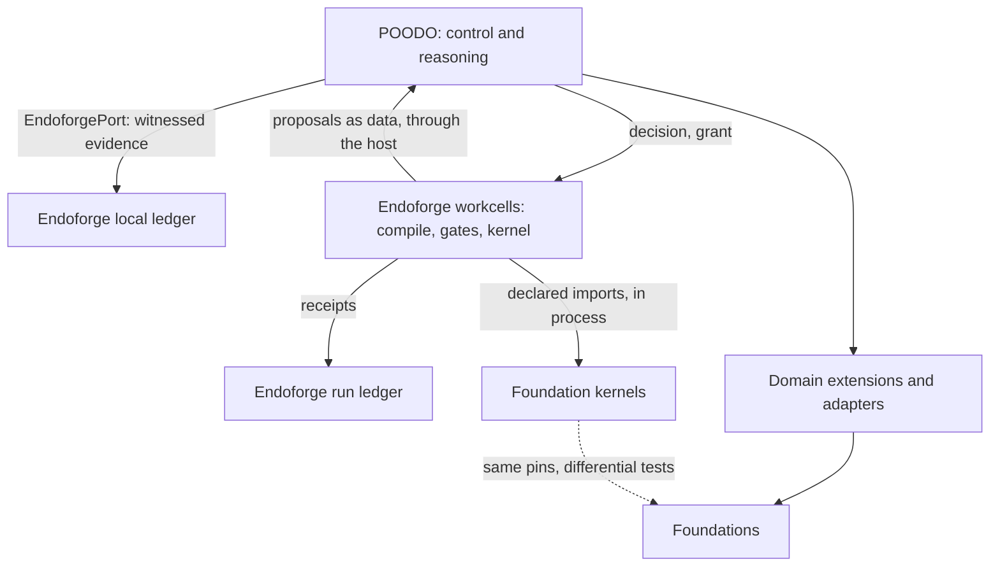

# Cstack

Cstack: template for a bot fleet under one human approver (GPL-3.0-only)

[](LICENSE)

## Status

Cstack is a template for running a fleet of AI bots under one human approver. Copy it, name your bots, plug in your own domains, and every action a bot takes goes through a control core that records goals, scoped authority and evidence.

This is an early template; verify the configuration and capabilities you choose.

## Quickstart

Python 3.11 or newer and Node 22 or newer on Linux or macOS. The spawn counter in the test suite needs Linux.

```sh
python3 -m venv .venv && . .venv/bin/activate
pip install -r requirements.txt -r ci/requirements.txt
npm ci --prefix adapters/workcell --ignore-scripts --no-audit --no-fund
cp cstack.config.example.json cstack.config.json
python -B cli.py < examples/scalar-and-negative.json
python -B -m unittest discover -s tests
bash ci/run-local.sh python links
```

## CLI approval

Calls may add `"effect": "ask"`; omitted effects remain `allow`. Ask restricts every
call of the same operation in that run. It cannot add a capability or grant.

```sh
python -B cli.py --approver < examples/ask-approval.json
python -B cli.py --approver=deny < examples/ask-approval.json
python -B cli.py --approver=file:answers.json < examples/ask-approval.json
```

Bare `--approver` prompts on the controlling terminal (`/dev/tty`) while stdin
carries JSON. Type exactly `approve` to approve the displayed request. Without
an approver, or without a usable terminal, ask is denied before dispatch.
The host-owned answer file is a JSON object mapping exact request SHA-256 digests
to `"approve"` or `"deny"`; an absent digest denies. Use `CapabilityRequest.sha256`
to compute the digest, also shown in the terminal prompt. Never take this file
or flag from tool output. Invalid files produce the structured driver error.
A denial returns the normal result with `run_status: "stopped"` and no dispatch;
it is not a tool outcome. Each invocation requires a new host approval record.

## Run a goal

A goal runs through the POODO core and comes back with a witnessed receipt:

```sh
CSTACK_STUB_TRANSPORT_SCRIPT=examples/forge/saturation-stub.json python -B cli.py < examples/forge/saturation-goal.json
```

The core makes the decision under a host grant and witnesses it. EndoForge then runs in `IsolatePool` V8 workcells: a model transport returns source, the pinned AssemblyScript compiler builds it in the cell, the real gates and frozen evaluator judge it, and the kernel calls the Foundations it declared as in-process imports. The EndoForge ledger and the receipt name the decision, grant, compiler and Foundation versions.

The controller and both ledgers stay outside the cohort. A lost cell, supervisor or controller is recorded as `outcome_unknown`, never as a pass, and isn't retried. A kernel can propose a decision only as data, through its host; the core accepts or refuses it. A run with a refusal records no pass.

This command uses the stub transport, which returns a recorded file. A real model transport goes behind the same `generate` function, selected only by `workcell.transport` in host configuration. Cstack ships none yet. See [the wiring acceptance](docs/verification/wiring-acceptance.md), [the Foundation routes](docs/verification/foundation-routes.md) and [the interface](docs/icd/icd-endoforge.md).

Workcells aren't an OS sandbox. Cgroup limits apply only where the host delegates them; the receipt says `cgroup: unavailable` where it doesn't.

## What is inside

| Path | What |
|---|---|
| `poodo_core/`, `contracts/`, `schemas/` | The control core: goals, phases, authority grants, decisions, attempts and evidence receipts, with the JSON contracts they obey |
| `adapters/`, `extensions/`, `bootstrap.py` | Capability ports: bounded stdio bridges from the core to each domain, registered once in `bootstrap.DOMAINS`, and the EndoForge workcell runtime in `adapters/workcell/` |
| `aors/`, `tools/` | The bot layer: areas of responsibility per bot, AOR sessions over MCP, fleet mail, approvals, a witnessed ledger, and the merge train |
| `foundations/` | Vendored Foundations: math research layer, film, refrigeration, robotics and the template to copy |
| `reasoning/poodo` | The POODO reasoning method the core enforces |
| `vendor/foundation-math-v014` | Foundation Math, byte-pinned |
| `ci/`, `.github/` | The local CI script and the GitHub workflow that calls it |

## Foundations

A Foundation is a domain package that Cstack runs through an adapter. Some are vendored, meaning copied into this repository, and the rest are only linked.

| Foundation | In this repository | How Cstack uses it |
|---|---|---|
| [foundation-math](https://github.com/Akilleez-QA/foundation-math) | `vendor/foundation-math-v014/`, plus the research layer in `foundations/math/` | Vendored copy of v0.14, run through `adapters/math_stdio.py` and `extensions/foundation_math.py` |
| foundation-film | [`foundations/film/`](foundations/film/) | Vendored copy, byte-pinned |
| foundation-refrigeration | [`foundations/refrigeration/`](foundations/refrigeration/) | Vendored copy, byte-pinned. Also an in-process kernel in workcells |
| foundation-robotics | [`foundations/robotics/`](foundations/robotics/) | Vendored copy, byte-pinned |
| foundation-template | [`foundations/template/`](foundations/template/) | Vendored copy, byte-pinned. Also an in-process kernel in workcells |
| [foundation-engine](https://github.com/Akilleez-QA/foundation-engine) | Not included | Linked only. No adapter or pin yet |
| [endoforge](https://github.com/Akilleez-QA/endoforge) | [`vendor/endoforge/`](vendor/endoforge/), byte-pinned | Lifecycle, gates, ledger and `IsolatePool`, run through `adapters/endoforge_workcell.py` |
| [poodo](https://github.com/Akilleez-QA/poodo) | `reasoning/poodo/` | Earlier snapshot of the skill that the core follows |

### How pins work

Cstack does not trust a vendored Foundation just because it is present. Each one ships a `SOURCE-MANIFEST.json` that lists a hash for every file. `contracts/SOURCE-PINS.json` records the expected hash of each manifest, and the adapters refuse to run a Foundation whose files or manifest don't match. To update a Foundation, copy in the new version, rebuild its manifest with its `tools/build_manifest.py`, update the pin, and run all the test suites on a reviewed branch. There is no automatic upgrade. The pin values are listed in [docs/icd/icd-foundations.md](docs/icd/icd-foundations.md). A matching pin proves that the bytes are unchanged. It does not prove that the content is correct.

## Verification

Run the root and Foundation unittest suites normally and with optimization enabled. `python -B tools/check_readme.py` runs every command in this file on a fresh clone.

## Define your bots

1. Edit `aors/fleet.json`. Each bot has a `slug`, the `slices` of the repo it owns, what it does not own, and `effects`. Anything that sends, pays, posts, files or deletes is `ask`, which routes to the one human approver.
2. Choose branch lanes for your own workflow.
3. Validate your registry with `adapters.aor_registry.load_fleet` against `contracts/aor.schema.json`:

   ```sh
   python -B -c "from adapters.aor_registry import load_fleet; print(load_fleet('aors/fleet.json').approver)"
   ```

4. Start a bot's AOR session over MCP. The host picks the bot and device; nothing a bot sends can change them:

   ```sh
   python -B tools/cstack_mcp.py --aor example --device example-host --state-root /tmp/cstack-state
   ```

## Wire the merge train

`tools/merge_train.py` merges open PRs in dependency order. A PR merges only when its body lists the local checks that were run, it stays inside its bot's slice, and it merges cleanly. It never deletes branches or force-pushes. It needs `gh` and a GitHub remote. Run it from a timer against a fresh worktree of `main`.

```sh
python3 tools/merge_train.py --wip
python3 tools/merge_train.py --dry-run --policy low-risk
```

## Add a domain

Copy `foundations/template`, rename it, add tools and their pins, and register it in `bootstrap.DOMAINS`. The refrigeration, film and robotics domains show three complete examples.

## Not included

No business data, no user or site data, and no engineering, safety or compliance determination. The example domains are references to learn from, not certified tools.

## Measured

Measured on 2026-11-01 with Python 3.14.8 on Linux at main commit
`ec416f05fc5a2233899afd3645f64a61ebc3be3d`, with `requirements.txt` and
`ci/requirements.txt` installed in `.venv`. CI: local only.

| Check | Command | Result |
|---|---|---|
| Core test suite | `python -B -m unittest discover -s tests` | 530 tests, OK, 2 skipped |
| Python suites and documentation links | `bash ci/run-local.sh python links` | Exit 0; root 530 tests in normal and `-O` mode (2 skipped each); film 25, refrigeration 18, robotics 49, template 34, math 10 in each mode, all OK; 18 paths checked, 0 broken |
| Secret scan | `bash ci/scan-secrets.sh` (TruffleHog) | 0 verified secrets; 2 unverified placeholder URLs, both in pip's vendored code inside the untracked `.venv` |

## Documentation

- [Project documents](docs/): requirements, architecture, Foundation interfaces, verification and configuration management.
- [Code comment rule](docs/rules/no-comments.md).
- [Control contracts](contracts/DECISION.md) and [capability contract](contracts/INTERFACES.md).


## Related projects

| Repository | Role | Relation |
|---|---|---|
| [cstack](https://github.com/Akilleez-QA/cstack) | Runs Foundations behind pinned adapters under one human approver | Host |
| [foundation-engine](https://github.com/Akilleez-QA/foundation-engine) | TypeScript and three.js framework for browser games | Foundation |
| [foundation-math](https://github.com/Akilleez-QA/foundation-math) | Exact mathematical kernels and physics research tools | Foundation |
| [foundation-film](foundations/film/) | Film-production acceptance checks | Foundation |
| [foundation-refrigeration](foundations/refrigeration/) | Refrigeration data and checks | Foundation |
| [foundation-robotics](foundations/robotics/) | Physics checks for motion | Foundation |
| [foundation-template](foundations/template/) | Minimal Foundation to copy for a new domain | Foundation |
| [endoforge](https://github.com/Akilleez-QA/endoforge) | Core engine for coding agents, checks, caching and evidence receipts | Execution substrate for forge goals, byte-pinned |
| [poodo](https://github.com/Akilleez-QA/poodo) | Reasoning skill that shows evidence before it acts | Tool |

Endoforge sits at the engine layer: forge goals run in its workcells with its gates and ledger. POODO runs on Endoforge as the control and reasoning layer (`poodo_core/`); domains and Foundations plug in through adapters. Foundations judge: a kernel's result is checked against the pinned Foundation, and producers don't grade themselves.

POODO uses its Foundation adapters for execution and can route witnessed evidence through `EndoforgePort`. Configure `endoforge.path` in repository-local `cstack.config.json` (see `cstack.config.example.json`); its parent directory must exist. Configured CLI runs witness precommits before dispatch and outcomes after execution, fail closed on storage errors, and report `endoforge_implemented: true`. Unconfigured runs report false. Running real coding agents and EndoForge's caching aren't wired yet: forge goals here have no real model transport. See the [Endoforge interface status](docs/icd/icd-endoforge.md).



## Layout

| Path | Contents |
|---|---|
| `README.md` | Status, setup and entry points |
| `docs/` | Requirements, architecture, interfaces, verification, configuration management and rules |
| `examples/` | CLI input examples |
| `tests/` | Root unittest suite |
| `cli.py`, `bootstrap.py`, `__init__.py`, `__main__.py` | Python entry points and composition kept at the repository root |

The root Python files stay at the top level on purpose.

## Contributing

See [CONTRIBUTING.md](CONTRIBUTING.md) for the contribution workflow and local checks.

## Security

See [SECURITY.md](SECURITY.md) for the security contact and reporting guidance.

## License

This project is available under the GNU General Public License v3.0 only (GPL-3.0-only). If you want to use it to create a product or service under different terms, commercial licenses are available from Refrigeration.AI. Contact craig@nh3.biz.
