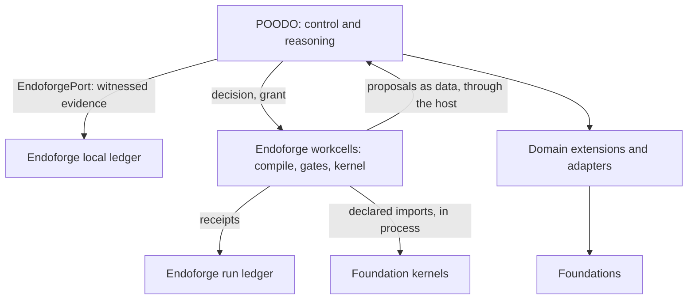
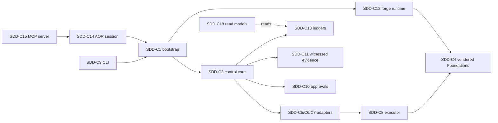

# Cstack software design description

| Field | Value |
|---|---|
| Document ID | CSTACK-SDD |
| Version | 2.0 |
| Status | Baselined |
| Owner | Akilleez-QA |
| Date | 2026-11-08 |
| Baseline commit | 6ae5481fd302439dabb23044d1b715ac8c4a9bec |
| Applies to | cstack main at baseline commit |
| Classification | Self-assessed Class E analog; not safety-critical (see [SMP §1](../plan/software-management-plan.md#1-software-classification-self-assessed)) |

> Organized after [NPR 7150.2D](https://nodis3.gsfc.nasa.gov/displayAll.cfm?Internal_ID=N_PR_7150_002D_&page_name=all), [NASA-STD-8739.8B](https://standards.nasa.gov/standard/nasa/nasa-std-87398) and the [NASA Software Engineering Handbook](https://swehb.nasa.gov/display/SWEHBVD/7.18+-+Documentation+Guidance) documentation guidance. This is not a NASA compliance determination or certification. The software classification is a self-assessed analog (Class E, not safety-critical); no NASA authority, independent verification and validation, or hazard analysis is asserted. The document describes the implementation inspected at the baseline commit.

## 1. Purpose and design boundary

Cstack composes a control core with trusted domain extensions and bounded capability adapters. The core records goals, decisions, attempts and evidence while the host owns concrete implementation selection. This description is for a reader about to change the code. It covers every component in the checkout; [requirements](../requirements/requirements.md) state what each must do, and the [interface documents](../icd/) pin each external boundary.

## 2. Design decisions

The decision records live in [`contracts/`](../../contracts/). Each one still governs the code:

| Record | Decision | Where it shows |
|---|---|---|
| [ADR 001](../../contracts/DECISION.md) | POODO control core with inherited lifecycle and host-owned authority | `poodo_core/`, `bootstrap.py` |
| [DECISION-003](../../contracts/DECISION-003-agent-aors-and-hmi.md) | Agents get areas of responsibility (AORs) and a human-machine interface | `aors/`, `adapters/aor_registry.py`, `adapters/aor_session.py` |
| [DECISION-004](../../contracts/DECISION-004-private-witnessed-ledger.md) | Private witnessed ledger with quorum gates | `adapters/witnessed_ledger.py`, `adapters/ledger.py` |
| [DECISION-005](../../contracts/DECISION-005-control-system-and-replaceable-adapters.md) | Eight lanes; adapters replaceable without touching the core | `poodo_core/models.py`, `contracts/ADAPTERS.json`, `tests/replaceability/` |
| [DECISION-006](../../contracts/DECISION-006-cstack-server.md) | One MCP server per bot, identity fixed at launch | `tools/cstack_mcp.py`, `adapters/mcp_stdio_server.py` |

Trade-offs that recur across components: fail closed rather than retry; treat an interrupted call as `unknown`, never as success; keep vendored code byte-identical and pin it; keep authority in host configuration, never in request data.

## 3. Engine layering and current implementation

The target design makes Endoforge the core engine for running coding agents with checks, caching and evidence receipts. POODO runs on Endoforge as the control and reasoning layer in `poodo_core/`. Domain extensions and adapters connect that layer to sibling Foundations, which own domain meaning and acceptance.

Two parts are implemented. `poodo_core/ports.py` specifies `EndoforgePort`, implemented by `adapters/endoforge_ledger.py`; bootstrap binds host-configured local storage and a fresh session for CLI runs, and the CLI reports `endoforge_implemented: True` only when bound. The workcell runtime runs one `cstack_forge` goal through a POODO decision into the vendored EndoForge `IsolatePool`, gates and run ledger (`adapters/endoforge_workcell.py`, `adapters/workcell/`). Running many coding agents at once and EndoForge's caching remain future work. The [Endoforge ICD](../icd/icd-endoforge.md) records storage guarantees, the runtime boundaries and their limits, and [the explanation](../guides/explanation/endoforge-vendoring.md) walks through a run.

POODO retains policy and execution admission; Endoforge is allocated witnessed storage only. The adapter validates the entire chain and outcome bindings on each operation, returns detached documents, and acknowledges single-write appends after fsync. A lifetime file lock excludes competing writers; hosts serialize calls and preserve the bound file identity. Local durability provides no external witness or suffix-rollback detection. The pinned lifecycle slice has no applicable storage primitive. `LedgerPort` remains separate. The file adapter implements CS-REQ-024–026 under the CS-REQ-020–023 port contract; CS-REQ-027–030 govern configured routing.

Configured cores witness decisions at creation and again before dispatch, including host approval records. Declines are witnessed before refusal. Precommit errors prevent dispatch and latch further witnessed work; outcomes are witnessed before normal completion. Outcome failures leave attempts consumed and budget/capacity holds unsettled for host reconciliation. Bootstrap owns storage lifetime; request data cannot select it. Unconfigured cores and AOR hosts retain their existing composition.

## 4. Decomposition and allocation

Each component lists the requirements allocated to it. `python -B tools/check_trace.py` checks that this table and the "Allocated to" fields of the requirements agree in both directions. Rows marked Infrastructure implement no CS-REQ requirement.

| ID | Element | Implementation | Responsibility | Requirements |
|---|---|---|---|---|
| SDD-C1 | Composition root | `bootstrap.py` | Registers domains and runtimes, selects roots, checks grants against the inventory, binds ledgers and constructs cores | CS-REQ-001, CS-REQ-002, CS-REQ-014, CS-REQ-066 |
| SDD-C2 | Control core | `poodo_core/` | Phases, goals and revisions, authority and lanes, approvals, budget, capacity, liveness, crash recovery and evidence admission | CS-REQ-012, CS-REQ-013, CS-REQ-037, CS-REQ-038, CS-REQ-040, CS-REQ-041, CS-REQ-042, CS-REQ-043, CS-REQ-044, CS-REQ-045, CS-REQ-046, CS-REQ-074, CS-REQ-075 |
| SDD-C3 | Contracts and inventory | `contracts/`, `schemas/`, `adapters/adapter_inventory.py` | Host/core and bridge data contracts; the adapter inventory and its checks | CS-REQ-036 |
| SDD-C4 | Vendored backends and Foundations | `vendor/foundation-math-v014/`, `vendor/foundation-engine-v020/`, `vendor/endoforge/`, `foundations/` | Byte-pinned upstream code: Math tools and bridge, Engine bridge, EndoForge slice, Template, Refrigeration, Robotics and Film Foundations, `fm_research` layer. Requirements live upstream | Infrastructure |
| SDD-C5 | Math adapter | `adapters/math_stdio.py`, `adapters/wire.py`, `extensions/foundation_math.py` | Dedicated pinned v0.14 protocol, strict wire parsing and schema enforcement, evidence ceiling | CS-REQ-003, CS-REQ-004, CS-REQ-005, CS-REQ-006, CS-REQ-007, CS-REQ-008, CS-REQ-015 |
| SDD-C6 | Sibling Foundation adapters | `adapters/foundation_stdio.py`, `adapters/film_stdio.py`, `adapters/refrigeration_stdio.py`, `adapters/robotics_stdio.py`, `adapters/template_stdio.py`, `extensions/foundation_film.py`, `extensions/foundation_refrigeration.py`, `extensions/foundation_robotics.py`, `extensions/foundation_template.py` | Profile-driven pins, schema checks and receipt binding for the vendored Film, Refrigeration, Robotics and Template Foundations | CS-REQ-064 |
| SDD-C7 | Engine adapter | `adapters/engine_stdio.py`, `extensions/foundation_engine.py` | Pinned partial copy of the Foundation Engine bridge; two read-only validators | CS-REQ-065 |
| SDD-C8 | Process executor | `adapters/execution.py` | Fixed module launch, deadlines, cancellation, output bounds and process-group cleanup | CS-REQ-009, CS-REQ-010, CS-REQ-011 |
| SDD-C9 | CLI driver and terminal approval | `cli.py`, `__main__.py`, `adapters/terminal_approver.py`, `tools/e2e_refrigeration.sh` | Reads one structured document, drives the core, asks for approval, prints one JSON result | CS-REQ-017, CS-REQ-018, CS-REQ-031, CS-REQ-067 |
| SDD-C10 | Approval store and scheduled approvals | `adapters/approval_store.py`, `adapters/private_sqlite.py`, `tools/scheduled_approvals.py` | Durable owner approvals: write once, consume once; the owner's ask list | CS-REQ-039, CS-REQ-056 |
| SDD-C11 | Witnessed evidence (EndoForge port) | `poodo_core/ports.py` (EndoforgePort), `adapters/endoforge_ledger.py` | Hash-chained, fsynced, exclusively locked evidence file; routing from configured cores | CS-REQ-020, CS-REQ-021, CS-REQ-022, CS-REQ-023, CS-REQ-024, CS-REQ-025, CS-REQ-026, CS-REQ-027, CS-REQ-028, CS-REQ-029, CS-REQ-030 |
| SDD-C12 | Forge runtime | `extensions/cstack_forge.py`, `adapters/endoforge_workcell.py`, `adapters/workcell/`, `adapters/workcell-toolchain/`, `tools/pin_workcell.py` | One governed EndoForge run per call in `IsolatePool` workcells, registered in `bootstrap.RUNTIMES` | CS-REQ-032, CS-REQ-033, CS-REQ-034, CS-REQ-035, CS-REQ-068, CS-REQ-069 |
| SDD-C13 | Local ledgers | `adapters/memory_ledger.py`, `adapters/durable_ledger.py`, `adapters/witnessed_ledger.py`, `adapters/ledger.py` | In-memory, durable JSONL and witnessed node-log implementations of `LedgerPort` | CS-REQ-047, CS-REQ-048 |
| SDD-C14 | AOR fleet and sessions | `aors/`, `adapters/aor_registry.py`, `adapters/aor_session.py`, `tools/e2e_agent.py` | Per-bot areas of responsibility, sessions over per-domain cores, end-to-end agent check | CS-REQ-049, CS-REQ-050, CS-REQ-051 |
| SDD-C15 | MCP server and client | `adapters/mcp_stdio_server.py`, `tools/cstack_mcp.py`, `adapters/mcp_stdio_client.py` | Agent-facing MCP server per bot; client for external MCP tool servers | CS-REQ-052, CS-REQ-053 |
| SDD-C16 | Fleet mail and relay | `adapters/fleet_mail.py`, `adapters/relay_outbox.py` | Signed bot-to-bot messages on GitHub issues; at-most-once relay outbox | CS-REQ-054, CS-REQ-055 |
| SDD-C17 | Memory store | `adapters/memory/` | SQLite/FTS5 store of host-sanitized facts with review, redaction and ingest | CS-REQ-062 |
| SDD-C18 | Read models and watchers | `adapters/read_models.py`, `adapters/host_read_models.py`, `tools/read_models.py`, `tools/runtime_watch.py`, `tools/witness_watch.py` | Read-only projections and alarms over ledgers and host state | CS-REQ-057, CS-REQ-058, CS-REQ-059, CS-REQ-060 |
| SDD-C19 | Provider policy | `adapters/provider_policy.py` | Failure classification, backoff, route ceilings and failover for model providers | CS-REQ-061 |
| SDD-C20 | Workspace snapshots | `adapters/workspace_snapshots.py`, `tools/snapshot_step.py` | Git-ref snapshots of a working tree for undo | CS-REQ-063 |
| SDD-C21 | Repository tools | `tools/check_links.py`, `tools/check_trace.py`, `tools/gen_data_dictionary.py`, `tools/check_readme.py`, `tools/claim_gate.py`, `tools/build_export_manifest.py`, `tools/merge_train.py`, `tools/pin_endoforge.py`, `ci/` | Documentation, claim, pin, export and merge tooling | CS-REQ-016, CS-REQ-070, CS-REQ-071, CS-REQ-072, CS-REQ-073, CS-REQ-076, CS-REQ-077 |
| SDD-C22 | Reasoning snapshot | `reasoning/poodo/`, `TODELETE/reasoning/poodo/` | Mirrored POODO skill subset and archived retired paths | CS-REQ-019 |
| SDD-C23 | Operator tools without tests | `tools/agent_profiles.py`, `tools/generate_aors.py`, `tools/measure_foundation_routes.py`, `tools/measure_routes_pyodide.mjs`, `tools/tty_approve.py`, `tools/fuzz_ports.py`, `tools/spawncount.py`, `tools/gen_release_docs.py` | Generators, measurement, release-record and test-support scripts; no CS-REQ requirement. `tools/spawncount.py` and `tools/fuzz_ports.py` are used by tests | Infrastructure |
| SDD-C24 | Examples and placeholders | `examples/`, `products/`, `workshop/`, `cstack.config.example.json` | Example documents and configuration; empty component areas | Infrastructure |

## 5. Control and data flow

1. The host selects a registered domain and creates a ToolFace grant for fixed operations and the selected goal.
2. The composition root checks the grant against `contracts/ADAPTERS.json` and binds the core to a ledger.
3. The caller supplies structured goal and request data. Core phase, revision, authority and decision checks precede execution.
4. The adapter checks source identity and probes the bridge catalog when needed. The executor launches a fixed bridge module from the trusted source root.
5. The bridge receives an initialization frame followed by a catalog or tool request. The adapter validates framing, correlation, schemas and evidence ceilings.
6. The core records the outcome and domain interpretation. A tool observation does not automatically accept the goal.

The Math adapter is intentionally separate from the shared sibling adapter: shared receipt-binding behavior must not be assumed to apply identically to Math. The per-domain schemas and adapter implementations govern the exact accepted structures.

## 6. Concurrency, timing and resources

- The core runs one operation at a time. A guard refuses mutating calls from hooks and from other threads while an operation runs; reads may re-enter (CS-REQ-043). Hosts serialize calls across threads.
- Foundation calls run as one child process per call through `adapters/execution.py`, with a deadline, stdin, stdout and stderr caps, and process-group kill on timeout, cancel or overflow (CS-REQ-009 to CS-REQ-011). Workcell routes call Foundations in process instead (CS-REQ-033); measured timings are in [Foundation routes](../verification/foundation-routes.md).
- Ledgers have one writer: `EndoforgeLedger` holds a lifetime file lock (CS-REQ-024); witnessed streams use claim files (CS-REQ-048); AOR sessions refuse a second live session (CS-REQ-050).
- The approval store, relay outbox and fleet-mail budget use SQLite or file locks so racing processes get one answer (CS-REQ-039, CS-REQ-054, CS-REQ-055).
- Budgets and capacity are counted in the core and restored from the ledger after a restart (CS-REQ-040, CS-REQ-041, CS-REQ-044).
- No component has a timing requirement beyond its deadlines. Resource bounds are the wire, output, document and ledger budgets named in the requirements.

## 7. Registration and replacement

Math and Template are registered unconditionally. Engine, Refrigeration, Robotics and Film are registered when their directories exist. The forge runtime is registered separately in `bootstrap.RUNTIMES`, so AOR sessions, which compose `DOMAINS`, never gain run authority. An unknown domain fails rather than falling back. The registry carries the capability class, extension class, source root, tool names, adapter identity and grant identity. Host construction accepts alternate roots; external JSON cannot select a root or add a domain.

Replacing a domain requires compatible descriptor, operations, inventory attachment, source pins, schemas and conformance evidence. Updating a source directory alone is insufficient. The research layer in `foundations/math/` is a separate consumer, not the Math stdio bridge root.

## 8. Reasoning method source

`reasoning/poodo/` contains the upstream POODO 3.1 skill and supporting material, distinct from the executable `poodo_core/`. The scoped source pin records a partial mirror; the legacy README and license remain deferred. Retired software-engineering extensions and old guide paths are archived under `TODELETE/reasoning/poodo/`; current guides use upstream `docs/guides/` paths.

## 9. External relationships

[Foundation Math](https://github.com/Akilleez-QA/foundation-math) is the named upstream for the byte-pinned historical distribution. Its current standalone extraction is narrower than this vendor tree; there is no demonstrated drop-in compatibility with upstream main.

[Foundation Engine](https://github.com/Akilleez-QA/foundation-engine) is partially vendored. `vendor/foundation-engine-v020/` holds only its Python bridge, the read-only tool schema and the upstream `SOURCE-MANIFEST.json`, pinned at upstream commit `70810ba455bdda1eadfdaab6bd44d43ae88f898c` in `contracts/SOURCE-PINS.json`. `adapters/engine_stdio.py` and `extensions/foundation_engine.py` expose two read-only validators, `validate_render_mask` and `validate_scene_output`. The engine's TypeScript runtime isn't included. The Math adapter still refuses a `foundation_engine` request (CS-REQ-015); Engine is its own domain.

[EndoForge](https://github.com/Akilleez-QA/endoforge) is vendored as a fixed slice in `vendor/endoforge/`; see [the source pin](../icd/icd-endoforge-pin.md).

## 10. Failure containment and state ownership

The claim-gate CLI has no approved-atoms Registry provider in this checkout. Requests using `--atoms` fail closed through its structured error path (CS-REQ-016); the CLI does not import an external checkout or skip atom validation. The programmatic `gate` function still accepts an explicitly supplied registry with a `resolve` method.

Malformed or over-budget data is rejected or quarantined. A failed source check prevents acceptance; timeouts and interrupted exchanges preserve uncertainty rather than retrying automatically. Process execution bounds are admission controls for trusted local tools, not a hostile-code sandbox.

`build_core` prevents duplicate live bindings to a ledger object or canonical path in one process. Hosts must serialize core calls across threads and provide exclusive cross-process store ownership. `build_domain` uses a fresh in-memory ledger; AOR sessions can select witnessed storage through host configuration. Durability is therefore a composition property, not a universal guarantee.

## 11. CLI approval and acceptance composition

### 11.1 Standalone CLI approval

The driver translates optional ask effects into restrictions on the fixed host
grant. Bootstrap supplies the ApprovalPort, named approver and clock to the core.
TerminalApprover prepares exact request-bound answers; PoodoCore validates and
consumes them before capability dispatch. Denial stops the run. Atomic exclusive
marker creation and directory fsync persist consumption across adapter instances;
records and the run ledger remain in memory. A new invocation creates new approval
IDs and requires a fresh answer. File answers are trusted host configuration.

### 11.2 Refrigeration acceptance composition

The CLI accepts trusted launch options `--config` and `--approver=file:<approval-store>`. Bootstrap distinguishes SQLite stores by their file header, preserving JSON answer files and terminal/deny modes. It opens the existing SQLite approval store through ApprovalReader, fixes the approver identity to `owner-via-approver`, and marks the domain's grant operations as ask. Requests cannot select policy or mint approvals. The reader and Endoforge port close on exit. The acceptance harness records a synthetic host verdict with ApprovalWriter before launching a separate CLI process; Foundation execution and evidence persistence use production adapters.

## 12. Quality attributes

| Attribute | How the design addresses it |
|---|---|
| Correctness of evidence | Pins and digests on every vendored part; quarantine on mismatch; evidence ceilings (SDD-C5 to SDD-C7, SDD-C12) |
| Availability | Not a service; no availability target. Fail-closed refusals favour stopping over guessing |
| Maintainability | One concern per component; replaceable adapters behind core ports (CS-REQ-075); no code comments, with rationale in docs and commit messages |
| Security | Authority only from host configuration; untrusted requests bounded and validated; secret scanning in CI ([SECURITY.md](../../SECURITY.md)). A workcell or process boundary is not a hostile-code sandbox |
| Testability | Every component except infrastructure rows has requirements with tests; fakes per lane (`tests/replaceability/`) |
| Usability | One JSON document in, one JSON result out (CLI); MCP tools with fixed identity |

## 13. Assurance and review limits

Review import direction, grant checks, evidence interpretation and process cleanup when changing the boundary. The tests exercise bounded behavior and rejection cases; they do not establish general mathematical truth or suitability for physical control. No refrigeration control, safety or compliance determination is provided by the example domains. See [limitations](../guides/explanation/limitations.md).

## Licensing

GPL-3.0-only. Commercial licenses under different terms are available from Refrigeration.AI; contact craig@nh3.biz. See the repository LICENSE and NOTICE.md for bundled notices.

## Change history

| Version | Date | Commit | Change | Reviewed in |
|---|---|---|---|---|
| 1.x | 2026-10 to 2026-11-08 | various | Foundation integration, EndoForge evidence and workcell runtime sections | See `git log -- docs/architecture/architecture.md` |
| 2.0 | 2026-11-08 | 6ae5481fd302439dabb23044d1b715ac8c4a9bec | Family standard format; numbered sections; component table covers every directory with requirement allocation; design decisions, concurrency and quality attributes added | docs/nasa-standard PR |
