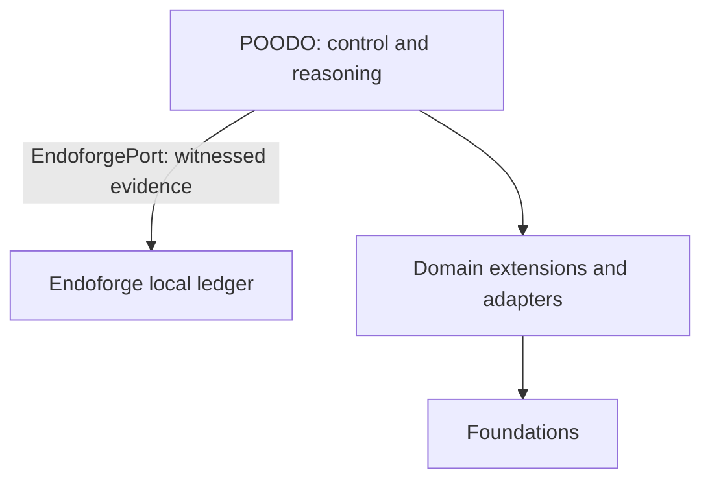

# Cstack software design description

Status: reusable documentation baseline; approval is through repository review. This document describes inspected implementation, not a NASA compliance determination or certification.

Organization follows the requirements, design, traceability and configuration-control concerns of [NPR 7150.2](https://nodis3.gsfc.nasa.gov/displayAll.cfm?Internal_ID=N_PR_7150_002D_&page_name=all) and [NASA-STD-8739.8](https://standards.nasa.gov/standard/nasa/nasa-std-87398). No NASA software classification, hazard analysis or independent verification is asserted.

## Purpose and design boundary

Cstack composes a control core with trusted domain extensions and bounded capability adapters. The core records goals, decisions, attempts and evidence while the host owns concrete implementation selection. This description covers the Foundation integration and its control path. Source files refer to ADR identifiers, but the inspected export does not contain those ADR documents.

## Intended engine layering and current implementation

The target design makes Endoforge the core engine for running coding agents with checks, caching and evidence receipts. POODO runs on Endoforge as the control and reasoning layer in `poodo_core/`. Domain extensions and adapters connect that layer to sibling Foundations, which own domain meaning and acceptance.

`poodo_core/ports.py` specifies `EndoforgePort`, implemented by `adapters/endoforge_ledger.py`. Bootstrap binds host-configured local storage and a fresh session for CLI runs; the CLI reports `endoforge_implemented: True` only when bound. Evidence routing is implemented; the intended agent runner and cache remain future work. The [Endoforge ICD](../icd/icd-endoforge.md) records storage guarantees and limits.

POODO retains policy and execution admission; Endoforge is allocated witnessed storage only. The adapter validates the entire chain and outcome bindings on each operation, returns detached documents, and acknowledges single-write appends after fsync. A lifetime file lock excludes competing writers; hosts serialize calls and preserve the bound file identity. Local durability provides no external witness or suffix-rollback detection. The pinned lifecycle slice has no applicable storage primitive. `LedgerPort` remains separate. The file adapter implements CS-REQ-024–026 under the CS-REQ-020–023 port contract; CS-REQ-027–030 govern configured routing.

Configured cores witness decisions at creation and again before dispatch, including host approval records. Declines are witnessed before refusal. Precommit errors prevent dispatch and latch further witnessed work; outcomes are witnessed before normal completion. Outcome failures leave attempts consumed and budget/capacity holds unsettled for host reconciliation. Bootstrap owns storage lifetime; request data cannot select it. Unconfigured cores and AOR hosts retain their existing composition.

## Decomposition and allocation

| Element | Implementation | Responsibility |
|---|---|---|
| Composition root | `bootstrap.py` | Registers domains, selects roots, checks grants and constructs cores |
| Control core | `poodo_core/` | Phase, authority, decision and evidence lifecycle |
| Contracts | `contracts/`, `schemas/` | Structured host/core and bridge data contracts |
| Domain extensions | `extensions/foundation_*.py` | Descriptors, admission and interpretation with stated evidence limits |
| Math adapter | `adapters/math_stdio.py` | Dedicated pinned v0.14 protocol and schema enforcement |
| Shared Foundation adapter | `adapters/foundation_stdio.py` | Profile-driven pins, schema checks and receipt binding for the vendored Film, Refrigeration, Robotics and Template Foundations |
| Process executor | `adapters/execution.py` | Fixed module launch, deadlines, cancellation, output bounds and cleanup |
| Math backend | `vendor/foundation-math-v014/` | Vendored exact/formal tools and bridge |
| Local domains | `foundations/template/`, `foundations/refrigeration/`, `foundations/robotics/`, `foundations/film/` | Domain bridges, public example logic, tests and source manifests |
| Research consumer | `foundations/math/` | `fm_research` claim DAG and exact-kernel research layer over vendored Math |

## Control and data flow

1. The host selects a registered domain and creates a ToolFace grant for fixed operations and the selected goal.
2. The composition root checks the grant against `contracts/ADAPTERS.json` and binds the core to a ledger.
3. The caller supplies structured goal and request data. Core phase, revision, authority and decision checks precede execution.
4. The adapter checks source identity and probes the bridge catalog when needed. The executor launches a fixed bridge module from the trusted source root.
5. The bridge receives an initialization frame followed by a catalog or tool request. The adapter validates framing, correlation, schemas and evidence ceilings.
6. The core records the outcome and domain interpretation. A tool observation does not automatically accept the goal.

The Math adapter is intentionally separate from the shared sibling adapter: shared receipt-binding behavior must not be assumed to apply identically to Math. The per-domain schemas and adapter implementations govern the exact accepted structures.

## Registration and replacement

Math and Template are registered unconditionally. Refrigeration, Robotics and Film are registered when their directories exist. An unknown domain fails rather than falling back. The registry carries the capability class, extension class, source root, tool names, adapter identity and grant identity. Host construction accepts alternate roots; external JSON cannot select a root or add a domain.

Replacing a domain requires compatible descriptor, operations, inventory attachment, source pins, schemas and conformance evidence. Updating a source directory alone is insufficient. The research layer in `foundations/math/` is a separate consumer, not the Math stdio bridge root.

## Reasoning method source

`reasoning/poodo/` contains the upstream POODO 3.1 skill and supporting material, distinct from the executable `poodo_core/`. The scoped source pin records a partial mirror; the legacy README and license remain deferred. Retired software-engineering extensions and old guide paths are archived under `TODELETE/reasoning/poodo/`; current guides use upstream `docs/guides/` paths.

## External relationships

[Foundation Math](https://github.com/Akilleez-QA/foundation-math) is the named upstream for the byte-pinned historical distribution. Its current standalone extraction is narrower than this vendor tree; there is no demonstrated drop-in compatibility with upstream main.

[Foundation Engine](https://github.com/Akilleez-QA/foundation-engine) is a linked sibling and design reference. `NOTICE.md` lists it as linked, not included; the vendored `docs/PROVENANCE.md` describes the reusable-core/optional-capability pattern without incorporating its runtime. `foundation_engine` remains an unimplemented sibling contract in `extensions/foundation_math.py`. There is no registered engine adapter, runtime source tree or engine commit pin in this Cstack baseline.

## Failure containment and state ownership

The claim-gate CLI has no approved-atoms Registry provider in this checkout. Requests using `--atoms` fail closed through its structured error path (CS-REQ-016); the CLI does not import an external checkout or skip atom validation. The programmatic `gate` function still accepts an explicitly supplied registry with a `resolve` method.

Malformed or over-budget data is rejected or quarantined. A failed source check prevents acceptance; timeouts and interrupted exchanges preserve uncertainty rather than retrying automatically. Process execution bounds are admission controls for trusted local tools, not a hostile-code sandbox.

`build_core` prevents duplicate live bindings to a ledger object or canonical path in one process. Hosts must serialize core calls across threads and provide exclusive cross-process store ownership. `build_domain` uses a fresh in-memory ledger; AOR sessions can select witnessed storage through host configuration. Durability is therefore a composition property, not a universal guarantee.

## Assurance and review limits

Review import direction, grant checks, evidence interpretation and process cleanup when changing the boundary. The tests exercise bounded behavior and rejection cases; they do not establish general mathematical truth or suitability for physical control. No refrigeration control, safety or compliance determination is provided by the example domains.

## Licensing

GPL-3.0-only. Commercial licenses under different terms are available from Refrigeration.AI; contact craig@nh3.biz. See the repository LICENSE and NOTICE.md for bundled notices.

## Standalone CLI approval

The driver translates optional ask effects into restrictions on the fixed host
grant. Bootstrap supplies the ApprovalPort, named approver and clock to the core.
TerminalApprover prepares exact request-bound answers; PoodoCore validates and
consumes them before capability dispatch. Denial stops the run. Atomic exclusive
marker creation and directory fsync persist consumption across adapter instances;
records and the run ledger remain in memory. A new invocation creates new approval
IDs and requires a fresh answer. File answers are trusted host configuration.
