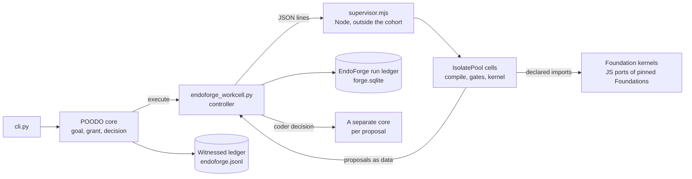

# How Cstack vendors and runs EndoForge

Cstack and [EndoForge](https://github.com/Akilleez-QA/endoforge) are the two halves of the project code-named Mjölnir. EndoForge is the engine: it compiles, gates and judges candidate code in V8 workcells and keeps a ledger of what happened. Cstack is the host: it owns goals, authority, approvals and the witness. This page explains how Cstack carries EndoForge and how a forge goal crosses between them. The commands are in [repin EndoForge](../how-to/repin-endoforge.md); the contracts are in [the EndoForge interface](../../icd/icd-endoforge.md) and [its source pin](../../icd/icd-endoforge-pin.md).

## Why a vendored copy

Cstack doesn't install EndoForge as a package or fetch it at run time. It keeps a copy of a fixed set of EndoForge files in `vendor/endoforge/`, taken from one commit on EndoForge `main`.

That gives three properties:

- **The bytes are the reviewed bytes.** `vendor/endoforge/SOURCE-MANIFEST.json` lists the hash of every file, and `contracts/SOURCE-PINS.json` records the hash of that manifest. Every forge run checks both before it starts, and stops with nothing run if a byte differs.
- **No network or registry at run time.** After the pip and npm installs, a clone has every EndoForge file a run uses.
- **Upstream moves on its own schedule.** EndoForge `main` changes often. Cstack takes a change only through a repin pull request, which is reviewed and runs every suite.

The cost is that the copy falls behind. A pin says the bytes are unchanged. It doesn't say they are correct, and it doesn't say they are current.

## What is in the slice

The slice is the `SLICE` list in `tools/pin_endoforge.py`. It has 25 files:

| Part | Files | Used by Cstack for |
|---|---|---|
| Lifecycle model | `vendor/endoforge/core/__init__.py`, `vendor/endoforge/core/lifecycle.py`, `vendor/endoforge/tests/test_endoforge_core_boundary.py` | The import-boundary test that the pin test runs |
| Run ledger | `vendor/endoforge/core/ledger/` | `Ledger` and `FrozenEvaluators`, which `adapters/endoforge_workcell.py` imports to freeze the evaluator and read receipts |
| Gates and evaluator | `vendor/endoforge/core/engine/` | The universal gates and frozen evaluator that judge each candidate inside a cell |
| Workcell runtime | `vendor/endoforge/core/runtime/isolate-*.mjs` | `IsolatePool`, which `adapters/workcell/supervisor.mjs` imports, and the cells, WASM limits, cgroup attachment and ledger bridge it uses |
| Capacity planner | `vendor/endoforge/core/runtime/capacity/` | Nothing at run time. It is carried because its CLI is its interface for non-Node callers. Since EndoForge P-68, `IsolatePool` doesn't import it, and Cstack sets the pool size itself (`workcell.size`, default 1) |
| Support | `vendor/endoforge/tools/factory_quality/index.mjs`, `vendor/endoforge/tools/ledger_writer.py`, `vendor/endoforge/LICENSE` | Contract and signature checks the gates import; the group-commit ledger writer the ledger bridge runs |

Everything else in EndoForge stays out: the agent pool and loop, the oracle, caching, experiments and the other tools. Cstack doesn't run coding agents through EndoForge's own loop; it runs one governed goal through the pool.

The export removes Python comment tokens, to follow Cstack's [no-comments rule](../../rules/no-comments.md), and copies every other byte unchanged. The manifest records both the upstream hash and the exported hash of each file, so the copy can be traced back.

The AssemblyScript compiler (0.28.20, with binaryen and long) isn't vendored. It is an npm dependency locked in `adapters/workcell-toolchain/package-lock.json`, and `adapters/workcell/compiler.mjs` checks its file hashes before every run.

## Two pins, one runtime

A forge run depends on two trees, and each has its own pin:

- `vendor/endoforge/`, pinned by the `endoforge` record (commit, manifest hash, file count, and whether the commit is on `main`);
- `adapters/workcell/`, Cstack's own side of the runtime, pinned file by file in the `workcell_runtime` record.

`verify_runtime()` in `adapters/endoforge_workcell.py` checks both and returns one digest of them. That digest is the `runtime_pin_sha256` in every receipt.

## How a forge goal runs

1. The CLI starts the goal and the core records a decision for one `run_goal` call. `cstack_forge` is a runtime, not a Foundation: it is registered in `bootstrap.RUNTIMES`, separate from `DOMAINS`, so a bot's AOR session never gets run authority.
2. Before dispatch, the core witnesses its precommitment in the host's ledger.
3. The controller, `adapters/endoforge_workcell.py`, runs inside `core.execute`. It verifies the pins, freezes the evaluator in the EndoForge run ledger and starts one Node supervisor in its own process group.
4. The supervisor builds an `IsolatePool` with Cstack's host port and limits. It asks the configured transport for source, then runs the job in a cell: compile with AssemblyScript, run the gates, run the kernel against each case.
5. A kernel reaches a Foundation only through an import its binary carries, its request declares and the host allows. The call runs in process, through a JavaScript port of the pinned Foundation, and is attributed to the port and source hashes.
6. The frozen evaluator compares the kernel's outputs with the pinned Foundation's results on held-out checks that never reach the prompt.
7. A kernel can propose a decision only as data. The controller gives each proposal its own goal and its own core, so the running core stays single-caller.
8. The receipt comes back as the outcome and is witnessed.

The controller and both ledgers stay outside every cohort. If a cell or the supervisor dies, the attempt is recorded as `outcome_unknown` and isn't retried; the host may run it again with `cli.py --resume DECISION_ID`. If the controller itself dies, the next session reads the run ledger and settles what it can, once.

## Three ledgers

A forge run writes to three places, and they mean different things:

| Ledger | Owner | Holds |
|---|---|---|
| `endoforge.jsonl` (the `endoforge.path` setting) | Cstack, `adapters/endoforge_ledger.py` | The host's witness: a hash chain of precommitments and outcomes, fsynced before each is acknowledged |
| `forge.sqlite` (the `workcell.ledger` setting) | EndoForge, the vendored `core/ledger` | The run: frozen evaluator, candidates, receipts |
| `forge.sqlite.core/<session>.jsonl` | Cstack, `adapters/durable_ledger.py` | The forge session's core ledger, so a lost controller can be replayed |

The vendored ledger writer also keeps a journal. The controller sets `ENDOFORGE_LEDGER_JOURNAL` to `forge.sqlite.journal/` for every run, so nothing is written under the user's state directory.

## What this doesn't give you

- Workcells are V8 isolates, not an OS sandbox. Cgroup limits apply only where the host delegates them, and the receipt says so.
- V8 has no instruction fuel. `fuel` counts Foundation calls, and `jobTimeoutMs` stops a hung kernel.
- The witness is a local fsync, not an independent quorum.
- A passed candidate passed these gates and this frozen evaluator. It is not goal acceptance and not an engineering, safety or compliance determination.
- EndoForge features outside the slice, such as its agent loop, oracle and caching, aren't available through Cstack until a repin brings them in and Cstack wires them.

Return to the [explanation index](README.md).
