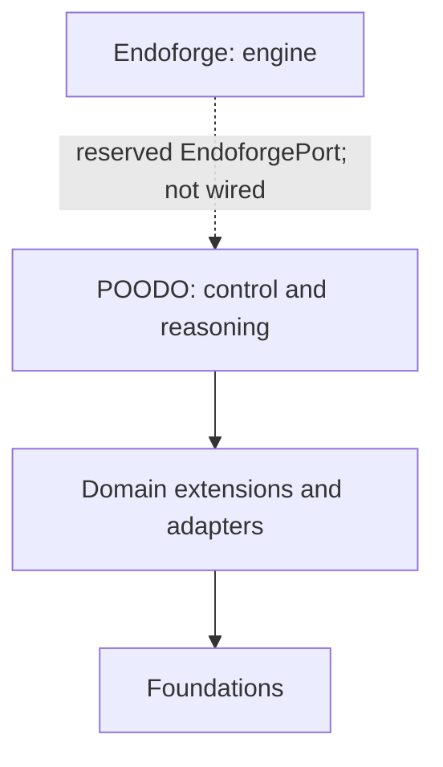

# Cstack–Endoforge interface status

## Intended allocation

Endoforge is the intended core engine: running coding agents with checks, caching and evidence receipts. POODO (`poodo_core/`) is the control and reasoning layer intended to run on Endoforge. Domains and Foundations connect through adapters. Foundations own domain meaning and acceptance; POODO owns goals, authority, decisions and evidence.

## Current evidence

Inspected against Cstack baseline `c84dcbde3a305fb35604dbdad239e608e4bf7c94`:

- `poodo_core/ports.py:64–70` declares `EndoforgePort(Protocol)`. Its docstring says “Reserved, UNIMPLEMENTED synthesis seam” and “intentionally exposes no callable synthesis method.” The class contains only that docstring.
- `cli.py:55` reports `"endoforge_implemented": False`.
- `extensions/foundation_math.py:53` describes the generator lifecycle as unimplemented.
- `git grep -n -i endoforge -- '*.py'` finds the reserved seam, inventory declarations, documentation strings, tests, an atom-data exporter and an optional approved-atoms registry import in the claim gate. These do not launch Endoforge or implement the seam. The optional registry source is absent from this baseline.
- `foundations/math/fm_research/problem.py:237–243` builds an `endoforge/atoms/1` data document; producing that document is not execution.

POODO does not run on Endoforge today. No callable Endoforge interface, runtime adapter or compatibility guarantee is established here.

## Source inclusion and future interface work

The current claim-gate CLI rejects `--atoms`, `--atom-refs` and `--consumer` requests with exit status 2 and a `cstack.claim-gate/0.1` JSON error on stderr stating that the approved-atoms Registry is unavailable. It emits no verdict on stdout. The pinned lifecycle slice does not provide that Registry; the dead optional import has been removed. Calls without atom options retain the ledger-only interface.

[PR #16](https://github.com/Akilleez-QA/cstack/pull/16) added a pinned lifecycle-core slice from Endoforge commit `cebd463ea9828dfd9bbf09181a631ee604eac8cf`. That slice contains data and lifecycle rules plus an import-boundary test. It has no agent runner, caching implementation or runtime wiring. Its source-pin ICD, [icd-endoforge-pin.md](icd-endoforge-pin.md), records the manifest hash. Vendoring source does not implement `EndoforgePort`.

A future interface must define callable operations and bind goals, Foundation capabilities, effects, artifacts, qualification, activation, disposal and retention to core-owned policy, as the reserved seam requires. Execution and proof authority must be specified and tested before the seam can be reported as implemented.
