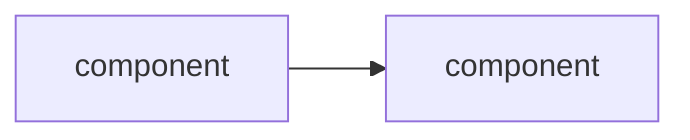

# <Repo> software design description

| Field | Value |
|---|---|
| Document ID | <CODE>-SDD |
| Version | 1.0 |
| Status | Draft |
| Owner | <maintainer handle, no @> |
| Date | <YYYY-MM-DD> |
| Baseline commit | <40-hex sha> |
| Applies to | <repo> <tag or "main at baseline commit"> |
| Classification | Self-assessed Class E analog; not safety-critical (see SMP §1) |

> Organized after [NPR 7150.2D](https://nodis3.gsfc.nasa.gov/displayAll.cfm?Internal_ID=N_PR_7150_002D_&page_name=all), [NASA-STD-8739.8B](https://standards.nasa.gov/standard/nasa/nasa-std-87398) and the [NASA Software Engineering Handbook](https://swehb.nasa.gov/display/SWEHBVD/7.18+-+Documentation+Guidance) documentation guidance. This is not a NASA compliance determination or certification. The software classification is a self-assessed analog (Class E, not safety-critical); no NASA authority, independent verification and validation, or hazard analysis is asserted. The document describes the implementation inspected at the baseline commit.

<!-- Template from family-doc-standard.md. Delete every HTML comment when instantiating. Delete a heading only with a one-line tailoring note in its place. -->

<!-- SWEHB 5.13. NPR SWE-057, 058, 052. Audience: someone about to change the code. Diagrams in Mermaid. -->

## 1. Purpose and design boundary

## 2. Design decisions and trade-offs

| Decision | Alternatives considered | Rationale | Requirements |
|---|---|---|---|

## 3. Architecture overview

<!-- Give at least a static (module) view and a runtime (process/data flow) view. -->

## 4. Components

| Component | Path | Responsibility | Inputs → outputs | Requirements |
|---|---|---|---|---|

<!-- Generate the path list from the package tree; write responsibilities by hand. Mark pure plumbing as "infrastructure". -->

## 5. Execution concept

<!-- Control flow, data flow, concurrency, timeouts, cancellation, ordering, state ownership. -->

## 6. Interfaces

<!-- Link each docs/icd/*.md; internal interfaces between components summarized here. -->

## 7. Failure handling and containment

<!-- What fails closed, what is quarantined, what is retried, what is never retried. -->

## 8. Resource use

<!-- Memory, processes, disk, network; bounds and where enforced. Measured values carry command and commit. -->

## 9. Quality attributes

<!-- Performance, availability, maintainability, security, testability, usability: how the design supports each. -->

## 10. Assumptions and limitations

## Change history

| Version | Date | Commit | Change | Reviewed in |
|---|---|---|---|---|
| 1.0 | <YYYY-MM-DD> | <sha> | Initial baseline | PR #<n> |
